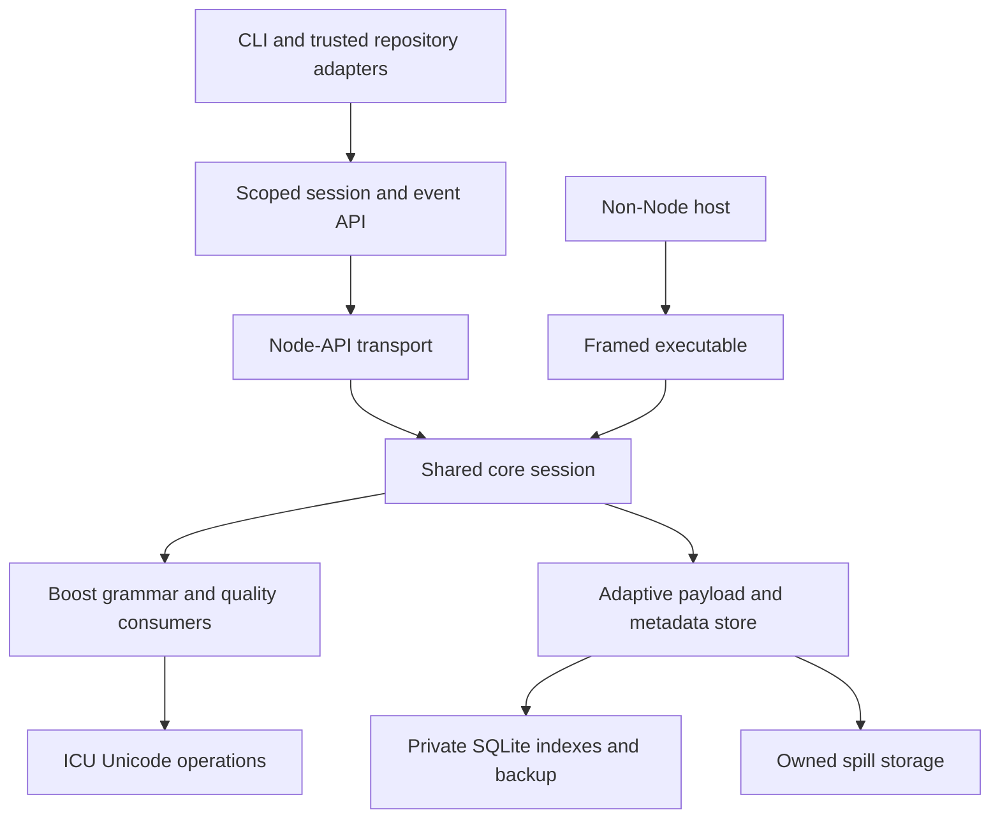

# Architecture

Cohort 2 uses one native C++20 service for strict JSON and JSONL checking.
Node-API and the framed executable transport bytes and controls to that service.
Neither implements a second parser or rule engine.
Installed resolution verifies a fixed platform artifact; source size never selects a backend.

## Ownership and lifecycle

`src/sessions.js` acquires the packaged component.
`session-surface.js` exposes scoped capabilities and backpressured events, and `value-session.js` binds references to their owning session.
`native-session.js` supplies serialized bounded exchanges.
Raw native IDs, backend selection and event projection are not public capability-minting interfaces.

`native/core/session.hpp` owns configure, immutable capture, parser/rule progress, value access, census and cleanup. Boost 1.92 is the strict syntax authority. ICU 79.1/Unicode 18 owns Unicode operations.
Decimal admission retains raw lexemes and uses exact reasoning before any declared conversion.
Presentation consumes the same parser callbacks and pinned serializer primitives; no scalable path constructs a JavaScript document DOM.

Payload segments, SQLite metadata, decoded/NFC values, pointers, findings, identities, census rows, retained controls and materialization reservations have explicit owners in the managed ledger. The store starts in memory and can transition once to owned disk. SQLite backup moves metadata into ordinary pages; payload/range identities remain stable.
A bounded immutable schema template is a separate module-level reserve with private per-session connections.
There is no input-result cache or shared mutable execution database.

Runtime controls stay finite when admission ceilings are removed.
Storage exhaustion, nesting/time limits, cancellation, invalid handles and incomplete source or diagnostic delivery refuse completion. Independent sessions do not share a checking lane or budget. The managed target excludes separately owned runtime/loader/OS and consumer allocations; whole-process RSS requires separate measurement.

## Repository composition

`policy-bootstrap.js` checks policy through the same core, reserves object conversion, validates local closed schemas with Ajv and transfers its frozen object charge into the main execution.
Bootstrap and main core lifetimes do not overlap.
Configuration never selects executable provider code or retrieves schemas.

`repository-discovery.js` reconciles streamed Git records and bounded owned-directory walks into the native census.
`repository-source.js` captures and rechecks regular source observations and exact bytes.
Hidden, untracked and ignored generated JSON remain obligations.
Tracked files inside excluded ancestors remain checked and protected from writes.

`native-provider.js` verifies actual physical authority captures, independent inventory and streamed members.
`logical-provider.js` selects actual frozen container values and transfers their UTF-8 or canonical Base64 bytes through the same core.
`source_census.hpp` independently reconciles membership, identities, provenance, provider minima and completed diagnostic streams.
Required logical pins reselect the actual source pointer/record and compare retained linkage.

`repository-check.js` rechecks source, policy, native authority, Git and directory observations before the sole final repository verdict.
Source terminals alone establish no complete repository claim.
Domain schemas and archive/RDF meaning remain with trusted consumer validators/adapters.

`qualification.js` composes a narrower immutable Git source owner: commit/type admission, trusted policy, streamed object-hash verification, native census and events.
It does not create a copied checkout or execute candidate tools, hooks or filters.
Its declared `immutable-git-json` scope does not qualify mutable working bytes.

## Explicit effects

`writers.js` admits finite producer/source transformations before acquisition or body copies. Prettier owns finite formatting; native source statistics and exact meaning comparison verify its candidates. NFC repair uses native string/key facts and collision preflight.
Producer-owned materialized values have their own declared serialization capability.

`source_rewrites.hpp` indexes selections and actual candidate captures within the same store.
`repository-rewrite.js` checks complete peer contracts and actual logical dependents before effects, then rechecks discovery and permissions around each rename.
On Windows it additionally resolves actual filesystem spelling so a Git casing alias cannot escape an excluded ancestor.
Native authority protection remains independently enforced in the core.

`guarded-replacement.js` owns one exclusive sibling stage, partial-write completion, permissions, fsync/close, staged-byte identity, original preimage recheck, rename and committed-path verification.
The policy is replaced last.
Batches are not atomic; failures report confirmed writes and any uncertain path.
Concurrent hostile mutation beyond the declared observation model is outside the replacement guarantee.

## Packaging and verification

`installed-component.js` resolves only the fixed `win32-x64` or `linux-x64` package location.
Missing or mismatched payloads fail; runtime compilation/download and environment-selected binaries are absent. The component/build manifests bind dependency versions, source/control identities, toolchain and artifact hashes.
`native/build.py` admits pinned producer inputs; `native/stage.py` verifies the exact closed payload before explicit staging.
Consumers need neither a compiler nor global ICU.

`installation.js` and `package-payload.js` retain exact selector, lock, npm-cache/SRI and installed-member verification. Package binaries have independent finite capabilities; the JSON source-byte admission is not a binary-size ceiling. Archive members and installed files are hashed incrementally without extraction. Installer/SDK memory ownership is separate from checker memory accounting.

The current local artifact is Windows x64.
Linux source/build paths and the selected hosted matrix require actual CI evidence before Linux acceptance; local Linux measurements were explicitly deferred by the requester.
Node-API compatibility, clean package transport, rights, non-Node supervision and whole-process measurements must be reported for the actual candidate.

## Development controls

The JavaScript identity ESLint plugin is separate from JSON parsing.
ESLint and `@eslint/json` are development dependencies; the latter also supports the immutable finite-v1 test oracle.
The oracle is excluded from npm membership and never selected at runtime.

Dependency-cruiser enforces package declarations, private/runtime boundaries, cycles and foundation direction. Native npm membership independently closes shipped imports and exports. The affected selector recognizes `.test.js` and `.test.mjs`, snapshots graph text/resources without native binary bodies, and binds source identity through bounded file hashing.
Unknown or non-import scope selects the full suite.

See [shared authority ownership](centralized-contracts.md), [resource controls](resource-limits.md), [consumer contracts](consumer-guide.md) and [native protocol](native-protocol.md).
Source correctness, independent review, security, hosted/platform qualification, package publication and downstream adoption remain separate evidence classes.
